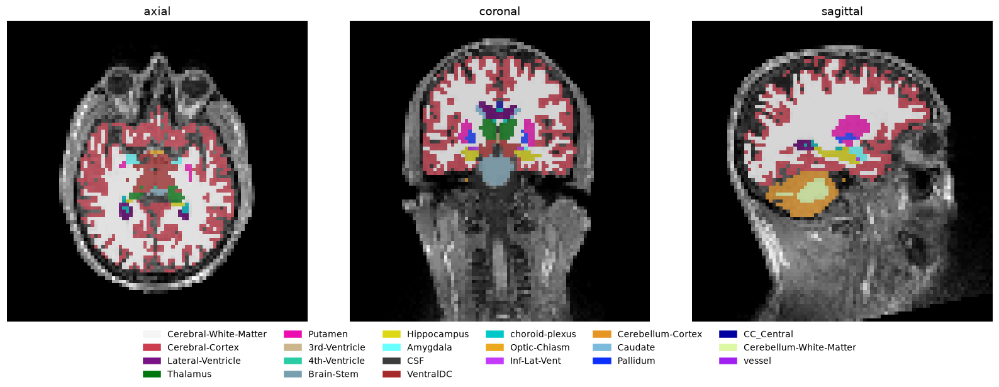

# Segmentation colour maps

[](https://github.com/anupbagale/segmentation-colormap/actions/workflows/ci.yml)
[](LICENSE)

Colouring label images with custom colour maps and lookup tables, in Python with NumPy and
Matplotlib. The main example draws a FreeSurfer brain segmentation on top of the MRI it came from,
using the colours and names from FreeSurfer's lookup table.



## Notebooks

| # | Notebook | What it covers | Colab |
|---|---|---|---|
| 1 | [Colour maps](notebooks/01_colormaps.ipynb) | continuous and listed colour maps, why label colours can shift, transparent backgrounds with `set_bad`, colour bars with names | [open](https://colab.research.google.com/github/anupbagale/segmentation-colormap/blob/main/notebooks/01_colormaps.ipynb) |
| 2 | [Brain segmentation with a lookup table](notebooks/02_segmentation_lookup_table.ipynb) | reading `.mgz` files and a FreeSurfer colour table, colouring 46 labels in one step, overlays in three views, structure volumes | [open](https://colab.research.google.com/github/anupbagale/segmentation-colormap/blob/main/notebooks/02_segmentation_lookup_table.ipynb) |

## The main idea

FreeSurfer labels are whole numbers between 0 and 255, with gaps (2, 3, 4, ..., 41, 42, ...,
255). Instead of remapping them to 0, 1, 2, ... and keeping a hand-written list in the same order,
make a table with a row for every possible label and index it directly:

```python
table = np.zeros((256, 4))          # R, G, B, alpha
for label, rgb in lut_rgb.items():
    table[label, :3] = rgb
    table[label, 3] = 0 if label == 0 else 1   # background transparent

colours = table[seg]                # one RGBA colour per voxel
```

This works for any scan, whatever labels it contains.

## Data

`data/` holds a T1-weighted MRI and its FreeSurfer segmentation (`aseg.mgz`) from the MNE-Python
"sample" subject, released under CC0, downsampled to 3 mm voxels. `data/aseg_lut.txt` lists the
name and colour of each label in FreeSurfer's lookup-table format. See
[data/README.md](data/README.md) for the source. In Colab the notebooks download these files
automatically.

## Running locally

```bash
git clone https://github.com/anupbagale/segmentation-colormap.git
cd segmentation-colormap
pip install -r requirements.txt
jupyter lab notebooks/
```

Both notebooks are run on GitHub after every change. To do the same locally:

```bash
pip install pytest nbmake
pytest --nbmake notebooks/
```

## License

Code: [MIT](LICENSE). The MRI data is CC0 (see [data/README.md](data/README.md)).
